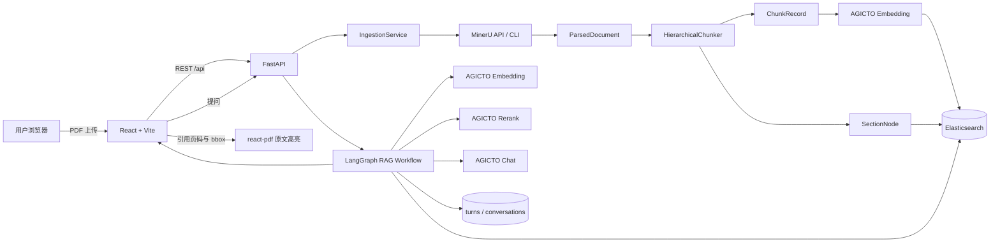

# LangGraph RAG 私有文档问答系统

面向中文 PDF 制度文档的私有知识库问答系统。项目将 MinerU 解析、章节层次切片、Elasticsearch 混合检索、AGICTO 模型服务和 LangGraph 工作流串成完整链路。回答严格限定在检索到的私有文档证据中，并返回文档、章节、页码、原文片段和 PDF 坐标，用于前端精确高亮。

当前版本适合个人或受控环境中的可用型原型，不是完整的多租户生产平台。

## 目录

- [1. 项目目标](#1-项目目标)
- [2. 当前能力](#2-当前能力)
- [3. 总体架构](#3-总体架构)
- [4. 核心数据流](#4-核心数据流)
- [5. 目录结构](#5-目录结构)
- [6. 技术栈](#6-技术栈)
- [7. 环境准备](#7-环境准备)
- [8. 配置说明](#8-配置说明)
- [9. 启动与使用](#9-启动与使用)
- [10. Elasticsearch 索引设计](#10-elasticsearch-索引设计)
- [11. 解析与层次切片](#11-解析与层次切片)
- [12. LangGraph 状态与节点](#12-langgraph-状态与节点)
- [13. 引用、拒答与多轮对话](#13-引用拒答与多轮对话)
- [14. HTTP API](#14-http-api)
- [15. 前端交互](#15-前端交互)
- [16. 测试、静态检查与评测](#16-测试静态检查与评测)
- [17. 当前评测基线](#17-当前评测基线)
- [18. 安全与数据边界](#18-安全与数据边界)
- [19. 常见问题排查](#19-常见问题排查)
- [20. 已知限制与演进方向](#20-已知限制与演进方向)
- [21. 维护入口](#21-维护入口)

## 1. 项目目标

系统的核心约束是“严格基于私有文档回答”：

1. PDF 入库后只从本地 Elasticsearch 检索证据。
2. 模型回答必须使用上下文中的 `[E1]`、`[E2]` 等证据编号。
3. 回答中的事实性结论应能追溯到文档、章节、页码和原文片段。
4. 没有足够证据或引用修复失败时明确拒答，不使用模型外部知识补齐。
5. 前端打开引用所在 PDF 页面，并根据解析坐标高亮原文。

当前支持文本型中文 PDF，不包含扫描件 OCR。证据片段会发送给云端模型，部署前需要确认数据合规要求。

## 2. 当前能力

### 已实现

- PDF 上传、落盘、SHA-256 摘要和文档状态管理。
- MinerU 云 API 或本地 CLI 解析。
- 解析标题层级、正文、列表、表格、公式、图片标题和页码坐标。
- 章节优先的层次切片，以及超长章节的固定长度切分和重叠。
- Elasticsearch BM25 与 `dense_vector` kNN 并行检索。
- 使用 RRF 融合 BM25 和向量结果。
- AGICTO Chat、Embedding 和 Rerank 接口。
- 多轮问题改写、多意图拆解、证据不足时最多一次检索重试。
- 基于 `[E-id]` 的引用校验和最多一次引用修复。
- 匿名 Cookie 会话、最近消息窗口、滚动摘要和会话恢复。
- React 网页端会话列表、新建、恢复、删除、文档上传、问答和 PDF 页码高亮。
- 98 题自动评测脚本，统计关键词、文档引用、高亮和延迟等指标。

### 尚未实现

- 账号登录、用户中心和文档权限控制。
- 多知识库或租户隔离。
- 扫描件 OCR。
- 生产级检查点、任务队列、限流和完整可观测性。
- 主张级事实蕴含校验；当前只校验引用编号是否合法。
- 固定 Top 8 在跨文档综合题中仍可能造成漏引。

## 3. 总体架构



系统分为四条链路：

1. 文档入库：上传、MinerU 解析、结构归一化、切片、向量化、写入索引。
2. 在线检索：问题改写、子问题规划、BM25 + kNN、RRF、Rerank。
3. 回答治理：证据判断、上下文编号、生成、引用验证、引用修复和拒答。
4. 交互展示：多轮问答、引用选择、PDF 页面渲染和 bbox 高亮。

## 4. 核心数据流

### 4.1 文档入库

1. `POST /api/documents` 接收 PDF，仅允许 `.pdf`。
2. 文件保存到 `DATA_DIR/uploads/<doc_id>/`，并计算 SHA-256。
3. 在 `rag_documents` 写入初始记录，状态为 `pending`。
4. FastAPI `BackgroundTasks` 异步执行 `IngestionService.ingest()`。
5. 状态更新为 `parsing`，调用 MinerU。
6. `content_list.json` 和布局信息归一化为 `ParsedBlock`。
7. `HierarchicalChunker` 生成 `SectionNode` 和 `ChunkRecord`。
8. 状态更新为 `indexing`，按每批 10 条调用 Embedding。
9. 章节和片段批量写入 `rag_sections`、`rag_chunks`。
10. 同一文档的旧版本片段标记为 `is_current=false`。
11. 状态更新为 `completed`，并设置 `active_version`。

```text
pending -> parsing -> indexing -> completed
                         |
                         +------> failed
```

### 4.2 在线问答

1. 浏览器携带 HttpOnly 匿名会话 Cookie 调用 `POST /api/chat`。
2. LangGraph 读取该会话的滚动摘要和最近消息窗口。
3. 多轮问题改写为不依赖上下文的独立问题。
4. 多意图问题最多拆成 3 个检索子问题。
5. 每个子问题分别执行 BM25 和向量检索，候选数默认 30。
6. 多路结果按片段去重，并融合各子问题的检索分数。
7. Rerank 重新打分，最终保留默认 Top 8。
8. 判断最高相关分数和每个子问题是否有足够证据。
9. 证据不足时改写查询并重试一次；仍不足则拒答。
10. 为最终证据分配 `E1`、`E2` 等编号，形成受控上下文。
11. Chat 模型生成带 `[E-id]` 引用的回答。
12. 后端检查引用编号是否属于证据集合。
13. 非法引用最多修复一次；修复后仍无合法引用则拒答。
14. 将问题和回答写入 `rag_turns`，并更新 `rag_conversations` 的消息计数。
15. 待总结消息达到阈值后，在后台增量压缩为会话摘要。

## 5. 目录结构

```text
langgraph RAG/
├─ backend/rag_app/
│  ├─ main.py                    # FastAPI、CORS、匿名会话中间件
│  ├─ config.py                  # Pydantic Settings
│  ├─ bootstrap.py               # 服务组装
│  ├─ api/routes.py              # HTTP 路由
│  ├─ graph/
│  │  ├─ state.py                # RAGState
│  │  ├─ nodes.py                # 检索、生成、引用与持久化节点
│  │  └─ workflow.py             # 节点和条件边
│  ├─ models/
│  │  ├─ document.py             # ParsedBlock、SectionNode、ChunkRecord
│  │  ├─ chat.py                 # Chat 请求、响应和 Citation
│  │  └─ conversation.py         # 会话、消息和详情模型
│  └─ services/
│     ├─ mineru.py               # MinerU API/CLI 适配
│     ├─ chunking.py             # 层次切片
│     ├─ elasticsearch.py        # 索引、检索、RRF、会话持久化
│     ├─ agicto.py               # Chat、Embedding、Rerank
│     ├─ memory.py               # 上下文裁剪、滚动摘要和轮次写入
│     └─ ingestion.py            # 入库编排
├─ frontend/src/
│  ├─ App.tsx                    # 上传、文档列表、对话
│  ├─ api.ts                     # 后端类型与请求封装
│  └─ components/PdfPreview.tsx  # PDF 页面和 bbox 高亮
├─ scripts/evaluate_rag.py       # 98 题评测脚本
├─ tests/                        # 切片、MinerU、节点和评测测试
├─ data/                         # 上传与解析运行时数据，已忽略
├─ .env.example                  # 配置模板，不包含密钥
├─ pyproject.toml
├─ uv.lock
└─ README.md
```

## 6. 技术栈

| 层次 | 技术 | 用途 |
|---|---|---|
| 后端 | Python 3.12 + uv | 服务、解析、检索和工作流 |
| Web API | FastAPI + Uvicorn | REST、上传和后台任务 |
| 数据校验 | Pydantic / pydantic-settings | API 模型和 `.env` 配置 |
| 工作流 | LangGraph | 状态图、条件边和检索治理 |
| 检索 | Elasticsearch 8 Async Client | BM25、kNN、nested 坐标和会话数据 |
| 解析 | MinerU v4 | 中文 PDF 结构化解析 |
| 模型网关 | AGICTO | Chat、Embedding、Rerank |
| 前端 | React 18 + TypeScript + Vite | 网页端交互 |
| PDF | react-pdf / pdfjs-dist | 页面渲染与 bbox 覆盖层 |
| 测试 | pytest / pytest-asyncio | 单元和行为测试 |
| 静态检查 | Ruff | Python lint 与导入排序 |

当前默认模型组合：

| 角色 | 默认模型 | 说明 |
|---|---|---|
| Chat / Generate | `qwen-plus` | 最终回答生成 |
| Fast / Rewrite | `qwen-plus` | 问题改写、子问题和重试 |
| Embedding | `text-embedding-v4` | 1024 维向量 |
| Rerank | `qwen3-rerank` | 候选片段重排 |
| MinerU | `vlm` | 中文 PDF，VLM 解析模式 |

模型名称都通过 `.env` 配置，不写死在代码中。

## 7. 环境准备

### 7.1 软件要求

- Windows、macOS 或 Linux。
- Python 3.12。
- [uv](https://docs.astral.sh/uv/)。
- Node.js 18+ 与 npm。
- Elasticsearch 8.x，本地默认 `http://127.0.0.1:9200`。
- 可访问 AGICTO API。
- MinerU 云 API Key，或本地可执行的 `mineru` 命令。

### 7.2 安装 Python 依赖

```powershell
uv sync
```

如果当前机器的 uv 缓存目录异常，可以为项目设置独立缓存：

```powershell
$env:UV_CACHE_DIR = "$PWD\.uv-cache"
uv sync
```

### 7.3 安装前端依赖

```powershell
cd frontend
npm install
```

### 7.4 启动 Elasticsearch

```powershell
Invoke-RestMethod http://127.0.0.1:9200
```

默认使用单分片、零副本。索引不存在时，后端启动阶段会自动创建：

- `rag_documents`
- `rag_sections`
- `rag_chunks`
- `rag_conversations`
- `rag_turns`

后端启动时如果 Elasticsearch 不可用，API 仍会启动，但文档与问答请求会失败；健康检查中的 `elasticsearch` 会显示为 `false`。

## 8. 配置说明

复制模板：

```powershell
Copy-Item .env.example .env
```

### 8.1 应用配置

| 变量 | 默认值 | 说明 |
|---|---|---|
| `APP_ENV` | `development` | `production` 时 Cookie 开启 `Secure` |
| `APP_HOST` | `127.0.0.1` | 后端监听地址 |
| `APP_PORT` | `8000` | 后端端口 |
| `APP_CORS_ORIGINS` | `http://localhost:5173` | 逗号分隔的前端来源 |
| `DATA_DIR` | `data` | 运行时数据根目录 |
| `UPLOAD_DIR` | `data/uploads` | PDF 文件目录 |
| `MINERU_OUTPUT_DIR` | `data/mineru` | 解析结果目录 |

### 8.2 Elasticsearch

| 变量 | 默认值 | 说明 |
|---|---|---|
| `ES_URL` | `http://127.0.0.1:9200` | Elasticsearch 地址 |
| `ES_USERNAME` | 空 | 可选基础认证用户名 |
| `ES_PASSWORD` | 空 | 可选基础认证密码 |
| `ES_USE_IK` | `false` | 为 `true` 时使用 `ik_max_word` / `ik_smart` |
| `ES_DOCUMENTS_INDEX` | `rag_documents` | 文档索引 |
| `ES_SECTIONS_INDEX` | `rag_sections` | 章节索引 |
| `ES_CHUNKS_INDEX` | `rag_chunks` | 检索片段索引 |
| `ES_CONVERSATIONS_INDEX` | `rag_conversations` | 会话索引 |
| `ES_TURNS_INDEX` | `rag_turns` | 对话轮次索引 |

只有在 Elasticsearch 已安装 IK 分词插件时，才能把 `ES_USE_IK` 设为 `true`。

### 8.3 AGICTO 模型

| 变量 | 示例 | 说明 |
|---|---|---|
| `AGICTO_BASE_URL` | `https://api.agicto.cn/v1` | OpenAI 兼容 API 根地址 |
| `AGICTO_API_KEY` | 必填 | API Key，禁止提交到版本库 |
| `AGICTO_CHAT_MODEL` | `qwen-plus` | 生成模型 |
| `AGICTO_FAST_MODEL` | `qwen-plus` | 改写、规划和重试模型 |
| `AGICTO_EMBEDDING_MODEL` | `text-embedding-v4` | 向量模型 |
| `AGICTO_EMBEDDING_DIMENSIONS` | `1024` | 必须与 ES 索引维度一致 |
| `AGICTO_RERANK_MODEL` | `qwen3-rerank` | 重排模型 |
| `AGICTO_TIMEOUT_SECONDS` | `90` | 云端模型超时 |

修改 `AGICTO_EMBEDDING_DIMENSIONS` 后，现有 `rag_chunks.embedding` 映射不会自动变更。必须重建索引并重新入库。

### 8.4 MinerU

| 变量 | 默认值 | 说明 |
|---|---|---|
| `MINERU_API_KEY` | 空 | 配置后优先使用云 API |
| `MINERU_BASE_URL` | `https://mineru.net/api/v4` | MinerU API 根地址 |
| `MINERU_MODEL_VERSION` | `vlm` | 解析模型版本 |
| `MINERU_COMMAND` | `mineru` | 未配置 API Key 时使用的本地命令 |
| `MINERU_POLL_INTERVAL_SECONDS` | `2` | 云 API 轮询间隔 |
| `MINERU_POLL_TIMEOUT_SECONDS` | `600` | 云 API 最长等待时间 |

### 8.5 切片与检索

| 变量 | 默认值 | 说明 |
|---|---|---|
| `CHUNK_TARGET_CHARS` | `500` | 超长章节的目标切片长度 |
| `CHUNK_MAX_SECTION_CHARS` | `1000` | 小于等于该值时不继续切分 |
| `CHUNK_OVERLAP_RATIO` | `0.15` | 相邻切片重叠比例，默认 75 字 |
| `RETRIEVAL_CANDIDATES` | `30` | 每条查询的候选数 |
| `RERANK_TOP_K` | `8` | 进入生成上下文的最大证据数 |
| `MIN_RERANK_SCORE` | `0.25` | 启用重排时，证据充分性的最低重排分 |
| `MIN_FUSION_SCORE` | `0.25` | 未启用重排时，证据充分性的最低融合分 |

### 8.6 会话记忆

| 变量 | 默认值 | 说明 |
|---|---|---|
| `MEMORY_RECENT_MESSAGES` | `12` | 每轮问答读取的最近消息数 |
| `MEMORY_CONTEXT_MAX_CHARS` | `6000` | 最近消息进入模型的总字符预算 |
| `MEMORY_SUMMARY_TRIGGER_MESSAGES` | `12` | 未总结消息达到该数量后刷新摘要 |
| `MEMORY_SUMMARY_WINDOW_MESSAGES` | `24` | 单次摘要最多读取的未总结消息数 |
| `MEMORY_SUMMARY_MAX_CHARS` | `1200` | 滚动摘要最大字符数 |

`.env` 已被 `.gitignore` 忽略。不要将真实 API Key、ES 密码或文档数据提交到公开仓库。

## 9. 启动与使用

### 9.1 启动后端

```powershell
uv run uvicorn rag_app.main:app --app-dir backend --host 127.0.0.1 --port 8000 --reload
```

验证：

```powershell
Invoke-RestMethod http://127.0.0.1:8000/api/health
```

接口文档：

- Swagger UI：`http://127.0.0.1:8000/docs`
- OpenAPI JSON：`http://127.0.0.1:8000/openapi.json`

### 9.2 启动前端

```powershell
cd frontend
npm run dev
```

访问 `http://127.0.0.1:5173`。Vite 会将 `/api` 代理到 `http://127.0.0.1:8000`。

### 9.3 使用流程

1. 在左侧知识库区域点击 `+`，上传 PDF。
2. 文档状态依次显示“等待解析、解析中、建立索引、可检索”。
3. 状态变为“可检索”后，在底部输入问题。
4. 回答中的引用可点击，右侧会打开对应 PDF 页面。
5. 原文命中坐标会以黄色矩形高亮，引用面板同时显示原文片段。

文档列表每 5 秒自动刷新。

## 10. Elasticsearch 索引设计

### 10.1 `rag_documents`

| 字段 | 类型 | 说明 |
|---|---|---|
| `doc_id` / `version_id` | `keyword` | 文档和入库版本 |
| `title` | `text + keyword` | 文档标题 |
| `file_name` / `file_hash` | `keyword` | 文件名和 SHA-256 |
| `page_count` | `integer` | 页数 |
| `parse_status` | `keyword` | 入库状态 |
| `storage_uri` | `keyword` | 本地路径，不参与索引 |
| `active_version` | `keyword` | 当前可检索版本 |
| `embedding_model` | `keyword` | 入库向量模型 |
| `chunker_version` | `keyword` | 切片算法版本 |
| `error_message` | `text` | 失败信息，不参与索引 |
| `created_at` / `updated_at` | `date` | 时间戳 |

### 10.2 `rag_sections`

保存标题层级树，用于章节追溯和后续父章节扩展。

| 字段 | 类型 | 说明 |
|---|---|---|
| `section_id` | `keyword` | 章节 ID |
| `doc_id` / `version_id` | `keyword` | 文档与版本 |
| `parent_section_id` / `child_ids` | `keyword` | 父子章节 |
| `level` / `order` | `integer` | 标题层级和顺序 |
| `heading` / `heading_path` | `text` | 标题和完整路径 |
| `page_start` / `page_end` | `integer` | 页范围 |
| `is_leaf` | `boolean` | 是否叶子章节 |
| `summary` | `text` | 预留字段 |

### 10.3 `rag_chunks`

在线检索的核心索引。

| 字段 | 类型 | 说明 |
|---|---|---|
| `chunk_id` | `keyword` | 片段 ID，格式为 `<section_id>:c0001` |
| `doc_id` / `version_id` | `keyword` | 文档与版本 |
| `document_title` | `text + keyword` | 文档标题 |
| `section_id` / `chunk_index` | `keyword/integer` | 章节和序号 |
| `text` | `text` | 正文，standard 或 IK 分词 |
| `heading_path` | `text` | 标题路径 |
| `page_start` / `page_end` | `integer` | 页码范围 |
| `source_spans` | `nested` | 原文坐标和引用文本 |
| `embedding` | `dense_vector` | 默认 1024 维、cosine |
| `char_count` | `integer` | 字符数 |
| `prev_chunk_id` / `next_chunk_id` | `keyword` | 相邻片段 |
| `is_current` | `boolean` | 是否为当前有效版本 |

`source_spans` 包含 `page_number`、`bbox`、`page_width`、`page_height` 和 `quote`。

### 10.4 `rag_conversations` 与 `rag_turns`

`rag_conversations` 保存会话 ID、匿名会话 ID、用户 ID、标题、滚动摘要、消息计数、最近消息时间和状态。当前 `user_id` 为 `null`。

| 字段 | 类型 | 说明 |
|---|---|---|
| `conversation_id` / `session_id` | `keyword` | 会话 ID 和匿名会话边界 |
| `title` | `text` | 首条用户消息生成的标题 |
| `summary` | `text` | 已压缩的滚动摘要 |
| `message_count` | `integer` | 会话累计消息数 |
| `summary_message_count` | `integer` | 已纳入摘要的消息数 |
| `last_message_at` | `date` | 最近消息时间，用于会话排序 |
| `summary_updated_at` | `date` | 最近摘要刷新时间 |
| `status` | `keyword` | 当前为 `active` |

`rag_turns` 保存用户与助手消息：

- `role` 为 `user` 或 `assistant`。
- `content` 不参与全文索引。
- `citations` 保存引用元数据，但 `index=false`。
- `evidence_sufficient` 和 `abstain_reason` 记录回答是否基于充分证据。
- `session_id` 和 `conversation_id` 共同限制读取范围。

摘要按 `summary_message_count` 之后的增量消息生成，避免每轮重复压缩全部历史。刷新在聊天响应完成后的后台任务中执行，不阻塞回答返回。

### 10.5 混合检索

BM25 查询字段：

```text
text^3, heading_path^2, document_title
```

kNN：

```text
field=embedding
similarity=cosine
num_candidates=max(size * 4, 50)
filter=is_current=true
```

RRF 融合：

```text
score(chunk) = Σ 1 / (60 + rank)
```

融合后再归一化排序。BM25 和向量召回只返回 `is_current=true` 的片段，避免旧版本参与回答。

## 11. 解析与层次切片

### 11.1 MinerU 输出归一化

适配器会查找 `*content_list.json` 或 `*middle.json`，并统一为 `ParsedBlock`：

- 去除页眉、页脚和页码块。
- 将 `page_idx` 转为从 1 开始的页码。
- 识别标题层级 `text_level` 或 `level`。
- 将表格 HTML 转为可读文本，并保留表格标题和脚注。
- 识别 `text`、`title`、`table`、`formula`、`list`、`caption`、`image`。
- 保存 bbox、页面宽高和原始顺序。
- 对归一化到 0-1000 的坐标，根据 PDF 页面尺寸还原。

### 11.2 层次切片策略

切片器名称为 `hierarchical-v1`，步骤如下：

1. 以文档标题创建根章节。
2. 根据标题层级构建 `SectionNode` 树和 `heading_path`。
3. 每个切片不允许跨越章节边界。
4. 章节总字符数不超过 `CHUNK_MAX_SECTION_CHARS` 时，生成一个完整片段。
5. 超长章节按正文块累积，达到目标长度后切分。
6. 单个文本块超过 500 字时，按 500 字切分。
7. 相邻文本片段使用 15% 重叠，默认 75 字。
8. 表格、公式和图片等原子块不与其他内容拼接。
9. 每个片段保存页码、bbox、quote 和前后片段 ID。

```text
第一章 客户信息保护
  ├─ section_id = <version>:s0001
  ├─ heading_path = [文档标题, 第一章 客户信息保护]
  └─ chunks:
       <section_id>:c0000
       <section_id>:c0001
       <section_id>:c0002
```

## 12. LangGraph 状态与节点

### 12.1 状态结构

`RAGState` 是 `TypedDict`，主要字段如下。

会话与请求：

- `conversation_id`
- `session_id`
- `request_id`
- `current_query`
- `messages`
- `conversation_summary`

检索：

- `standalone_query`
- `retrieval_queries`
- `missing_retrieval_queries`
- `retrieved_candidates`
- `reranked_evidence`
- `retrieval_round`
- `evidence_sufficient`
- `insufficiency_reason`

生成与引用：

- `context_pack`
- `evidence_map`
- `draft_answer`
- `final_answer`
- `citations`
- `citation_check`
- `invalid_evidence_ids`
- `valid_evidence_ids`
- `citation_repair_feedback`
- `repair_round`

运行控制：

- `abstain_reason`
- `status`
- `error`
- `trace`

### 12.2 节点职责

| 节点 | 输入重点 | 输出重点 |
|---|---|---|
| `load_context` | 会话 ID | 滚动摘要、受字符预算限制的最近消息、初始化计数 |
| `contextualize_query` | 当前问题和历史 | `standalone_query` |
| `plan_retrieval` | 独立问题 | 1-3 个 `retrieval_queries` |
| `retrieve` | 查询和向量 | 去重后的候选片段 |
| `rerank` | 候选片段 | Top 8 `reranked_evidence` |
| `assess_evidence` | 重排结果和阈值 | 是否充分、缺失子问题 |
| `rewrite_for_retry` | 缺失问题 | 新查询、`retrieval_round+1` |
| `compose_context` | 证据 | `E-id` 上下文和 `evidence_map` |
| `generate` | 问题、上下文、历史 | `draft_answer` |
| `verify_citations` | 草稿和证据编号 | 合法引用或失败原因 |
| `repair_citations` | 非法编号和证据 | 修复后的草稿 |
| `abstain` | 失败原因 | 固定拒答文本、空引用 |
| `persist_turn` | 最终回答 | 写入用户轮次和助手轮次 |

### 12.3 路由规则

```text
START
  -> load_context
  -> contextualize_query
  -> plan_retrieval
  -> retrieve
  -> rerank
  -> assess_evidence
       ├─ 证据充分 -> compose_context -> generate -> verify_citations
       ├─ 证据不足且未重试 -> rewrite_for_retry -> retrieve
       └─ 证据不足且已重试 -> abstain -> persist_turn -> END

verify_citations
  ├─ 合法 -> persist_turn -> END
  ├─ 非法且未修复 -> repair_citations -> verify_citations
  └─ 非法且已修复 -> abstain -> persist_turn -> END
```

检索重试最多一次，引用修复最多一次。当前图不依赖 `MemorySaver` 保存业务状态；会话摘要和轮次以 Elasticsearch 为唯一事实源，进程重启后仍可恢复。若后续增加中断、审批或长任务恢复，再单独引入持久化 LangGraph 检查点。

## 13. 引用、拒答与多轮对话

### 13.1 引用生成

`compose_context` 将每个证据格式化为：

```text
[E1] 文档：个人客户信息保护管理办法
章节：第四章 > 信息使用
页码：12
原文：...
```

系统提示词要求：

- 只能依据提供证据回答。
- 每个事实性结论后使用 `[E1]`、`[E2]` 形式。
- 证据不足时明确说明无法从文档确认。
- 不自行生成页码或文档链接。

### 13.2 引用校验

后端使用正则提取回答中的所有 `[E数字]`：

1. 如果回答没有任何引用，判定为 `missing_citation`。
2. 如果存在不在 `evidence_map` 中的编号，判定为 `invalid_citation`。
3. 非法引用只修复一次。
4. 修复后仍不合法，或没有合法引用，则拒答。
5. 合法引用转换为 `Citation`，包含文档、章节、页码、bbox、quote 和文件 URL。

当前校验只确认“引用编号合法”，不确认“每个事实是否真的由该片段蕴含”。这是后续提高可信度时必须补强的一项。

### 13.3 拒答

拒答文本为：

```text
无法从当前私有文档中找到足够证据回答这个问题。
```

常见拒答原因：

- `empty_retrieval`：没有检索结果。
- `low_relevance`：最高重排分低于阈值。
- `missing_subquery_evidence`：部分子问题没有足够证据。
- `invalid_citation_after_repair`：引用修复后仍非法。

### 13.4 多轮对话

- 浏览器使用 HttpOnly `rag_session` Cookie，有效期 30 天。
- 客户端首次提问后获得 `conversation_id`，并在左侧历史会话列表中恢复已有会话。
- 后续请求携带同一 `conversation_id`。
- 后端同时按 `session_id` 和 `conversation_id` 查询历史，避免跨会话读取。
- `load_context` 读取滚动摘要和最近 12 条消息，并按 6000 字预算从最新消息向前裁剪。
- 问题改写可同时参考摘要和最近 6 条消息；生成阶段参考摘要和最近 4 条消息。
- 历史消息和摘要只用于理解指代、延续话题，不作为事实证据；事实仍只能来自本轮检索片段。
- 每新增 12 条未总结消息，后台读取最近的未总结窗口生成摘要，并更新 `summary_message_count`。
- 前端支持新建、恢复和删除会话；删除会同时清除会话记录和该会话的全部轮次。

当前仍未实现会话重命名、导出和账号绑定。

## 14. HTTP API

所有接口前缀为 `/api`。

### `GET /api/session`

返回当前匿名会话 ID。

```json
{"session_id": "..."}
```

### `GET /api/health`

检查服务和外部依赖状态。

```json
{
  "status": "ok",
  "elasticsearch": true,
  "agicto_configured": true,
  "chat_model": "qwen-plus",
  "embedding_model": "text-embedding-v4",
  "mineru_api_configured": true
}
```

### `GET /api/documents`

列出文档，按创建时间倒序，默认最多 100 条。

### `POST /api/documents`

上传 PDF，使用 `multipart/form-data`，字段名为 `file`。成功返回 `202 Accepted`：

```json
{
  "doc_id": "...",
  "version_id": "...",
  "status": "pending"
}
```

正文解析和向量化在后台执行，客户端应轮询 `GET /api/documents`。

### `GET /api/documents/{doc_id}/file`

返回原始 PDF。后端会校验路径必须位于 `UPLOAD_DIR` 内，避免任意文件读取。

### `GET /api/conversations`

返回当前匿名会话下的历史会话，按最近消息时间倒序，默认最多 50 条。

主要字段包括 `conversation_id`、`title`、`summary`、`message_count`、`summary_message_count` 和 `last_message_at`。

### `GET /api/conversations/{conversation_id}`

返回会话元数据和按时间正序排列的完整消息列表。消息包含角色、正文、引用元数据、证据是否充分和创建时间。

如果 `conversation_id` 不属于当前匿名会话，返回 `404`。

### `DELETE /api/conversations/{conversation_id}`

删除会话及其全部轮次，成功返回 `204 No Content`。如果会话不存在或不属于当前匿名会话，返回 `404`。

### `POST /api/chat`

请求：

```json
{
  "message": "客户信息泄露时应在多久内报告？",
  "conversation_id": null
}
```

响应重点字段：

```json
{
  "conversation_id": "...",
  "answer": "应在 2 小时内报告。[E1]",
  "citations": [
    {
      "evidence_id": "E1",
      "chunk_id": "...",
      "doc_id": "...",
      "title": "个人客户信息保护管理办法",
      "heading_path": ["个人客户信息保护管理办法", "第四章 信息使用"],
      "page_start": 12,
      "page_end": 12,
      "source_spans": [
        {
          "page_number": 12,
          "bbox": [72.0, 160.0, 510.0, 182.0],
          "page_width": 595.0,
          "page_height": 842.0,
          "quote": "发生信息泄露的，应当在 2 小时内报告。"
        }
      ],
      "file_url": "/api/documents/<doc_id>/file"
    }
  ],
  "evidence_sufficient": true,
  "retrieval_round": 0,
  "retrieval_queries": ["客户信息泄露时应在多久内报告？"],
  "missing_retrieval_queries": [],
  "abstain_reason": "",
  "invalid_evidence_ids": [],
  "repair_attempts": 0,
  "trace": ["retrieve:1x:18", "rerank:8", "verify_citations:True"]
}
```

请求体限制：`message` 长度为 1-8000；`conversation_id` 可为空，为空时后端创建新 ID。

## 15. 前端交互

前端页面由三部分组成：

1. 顶部状态栏：显示 Elasticsearch 和 AGICTO 是否可用。
2. 左侧栏：上方管理知识库文档，下方展示历史会话，可新建、恢复和删除。
3. 中间对话与右侧 PDF 预览：显示回答、引用和原文高亮。

点击历史会话后，前端读取会话详情并恢复用户消息、助手回答和引用；刷新页面后可继续使用。删除当前会话时会清空对话区，但不会影响其他会话或知识库文档。

PDF 高亮使用归一化坐标：

```text
left   = x0 / page_width
top    = y0 / page_height
width  = (x1 - x0) / page_width
height = (y1 - y0) / page_height
```

只有同时包含 4 个 bbox 数值、页面宽高和页码的 `SourceSpan` 才会显示高亮。没有坐标时，引用仍然会在右侧显示原文 quote。

## 16. 测试、静态检查与评测

### 16.1 单元测试

Windows PowerShell：

```powershell
$env:PYTHONPATH = "."
uv run pytest -q
```

macOS / Linux：

```bash
PYTHONPATH=. uv run pytest -q
```

当前测试覆盖：

- 章节边界不被切片跨越。
- 超长章节产生重叠切片。
- MinerU 归一化 bbox 和表格内容。
- 多意图问题拆解。
- 检索结果去重和查询追踪。
- 非法引用检测、修复和拒答路由。
- 会话上下文裁剪、增量摘要和无快速模型时的摘要回退。
- 中文数字与单位的评测归一化。

### 16.2 静态检查

```powershell
uv run ruff check backend tests scripts
```

### 16.3 前端构建

```powershell
cd frontend
npm run build
```

当前构建已通过。Vite 会提示主 JS 包和 PDF worker 较大，这是引入 `react-pdf` / `pdfjs-dist` 后的体积警告，不影响构建成功。

### 16.4 评测脚本

评测脚本位于 `scripts/evaluate_rag.py`。输入数据集格式见 `RAG测试集.json`，每条问题包含：

- `id`
- `type`
- `difficulty`
- `question`
- `answer`
- `source_docs`
- `source_clauses`
- `keywords`

运行方式：

```powershell
uv run python scripts/evaluate_rag.py `
  --dataset "RAG测试集.json" `
  --base-url "http://127.0.0.1:8000" `
  --output "rag_eval_report.json" `
  --concurrency 3 `
  --retries 1 `
  --timeout 180
```

指标包括：

- 完成数、错误数。
- 关键词召回宏平均和加权平均。
- 引用文档召回宏平均。
- 引用出现率和所有期望文档均被引用率。
- 证据充分率、非法引用率和引用修复成功率。
- 多意图证据覆盖率和引用高亮覆盖率。
- 平均、P50 和 P95 延迟。
- 按题型和难度分组的表现。

自动指标是代理指标，不能完全替代人工对事实正确性、引用充分性、答案完整性和拒答正确性的评审。

## 17. 当前评测基线

最近一次保存在 `rag_eval_report_98_citation_fix.json` 的 98 题评测结果：

| 指标 | 结果 |
|---|---:|
| 完成题数 / 错误数 | 98 / 0 |
| 关键词召回宏平均 | 87.68% |
| 引用文档召回宏平均 | 92.24% |
| 引用出现率 | 100% |
| 所有期望文档均被引用率 | 83.67% |
| 引用高亮覆盖率 | 100% |
| 非法引用率 | 0% |
| 证据充分率 | 100% |
| 多意图证据覆盖率 | 100% |
| 平均延迟 | 16.18 秒 |
| P50 延迟 | 12.08 秒 |
| P95 延迟 | 43.19 秒 |

主要短板：

- 跨文档综合题的引用召回约 67.87%，固定 Top 8 容易牺牲文档多样性。
- 多跳推理题的关键词召回约 82.26%。
- 元数据题关键词召回约 66.67%，主要受回答表述方式影响。
- P95 延迟偏高，异步子查询、重排和长文本生成共同放大尾延迟。
- 自动指标高分不代表引用已经构成严格的事实蕴含证明。

## 18. 安全与数据边界

### 上传文件

- 只接受 PDF。
- 文件名经过 `Path(...).name` 处理，避免目录穿越。
- 文件路径在读取时再次校验必须位于 `UPLOAD_DIR`。
- 文件摘要可用于后续重复文件和版本识别，但当前未实现去重流程。

### API Key

- 所有密钥只应放在 `.env`。
- `.env`、`data/` 和日志已被 `.gitignore` 忽略。
- 不要在 README、前端代码、测试快照或提交记录中保存真实密钥。

### 数据外发

启用 AGICTO 后，以下内容会发送到云端：

- 用户问题。
- 会话历史中的最近消息。
- 检索或重排所需的问题和文档片段。
- 生成答案所需的完整证据上下文。

如果制度文档或用户问题属于敏感数据，必须先确认组织的数据处理和合规要求。

### 权限

当前没有文档权限和用户隔离。所有访问同一服务实例的会话都共享同一知识库，任何匿名会话都可以检索所有已入库文档。不能直接用于多用户、多部门或生产环境。

### 会话

匿名 Cookie 只用于区分浏览器会话，不是身份认证。生产环境需要 HTTPS、正式认证和会话审计。

## 19. 常见问题排查

### 19.1 Elasticsearch 连接失败

现象：

```text
Cannot connect to host 127.0.0.1:9200
```

处理：

1. 确认 Elasticsearch 进程已启动。
2. 执行 `Invoke-RestMethod http://127.0.0.1:9200`。
3. 检查 `.env` 中的 `ES_URL`、用户名和密码。
4. 查看 `GET /api/health` 中 `elasticsearch` 是否为 `true`。

如果 ES 使用 HTTPS 或自签证书，需要让客户端信任对应 CA。

### 19.2 AGICTO 显示未配置

检查 `AGICTO_BASE_URL`、`AGICTO_API_KEY` 和 `AGICTO_CHAT_MODEL`。健康检查只确认基础 URL 和 API Key 是否存在；模型名错误、额度不足或上游异常会在实际调用时返回错误。

### 19.3 MinerU 没有生成 `content_list.json`

云 API 模式：

- 检查 `MINERU_API_KEY`。
- 检查 `MINERU_BASE_URL` 和 `MINERU_MODEL_VERSION`。
- 查看 `data/mineru/` 下的 ZIP、Markdown 和日志。

本地 CLI 模式：

```powershell
mineru --version
```

如果命令不存在，需要安装 MinerU 或将可执行文件加入 `PATH`，也可以配置 `MINERU_COMMAND` 为绝对路径。

### 19.4 上传后一直处于解析或索引状态

- 查看后端控制台异常。
- 检查文档记录中的 `error_message`。
- 确认 MinerU 和 Embedding 服务可访问。
- 当前使用 FastAPI 进程内后台任务，进程在入库期间重启会中断任务。

### 19.5 回答没有引用或直接拒答

- 检查 `MIN_RERANK_SCORE` / `MIN_FUSION_SCORE` 是否过高。
- 检查重排模型是否配置正确。
- 检查文档是否已完成入库且 `is_current=true`。
- 检查问题是否包含文档中不存在的概念。
- 查看响应中的 `retrieval_queries`、`missing_retrieval_queries` 和 `trace`。

### 19.6 引用能打开 PDF，但没有高亮

通常是 `source_spans` 缺少 bbox 或页面宽高。检查 MinerU 是否返回坐标信息，以及解析结果是否正确保存了 `page_width` 和 `page_height`。

### 19.7 前端请求返回 CORS 错误

确保 `.env` 的 `APP_CORS_ORIGINS` 包含实际前端地址，例如：

```text
APP_CORS_ORIGINS=http://localhost:5173,http://127.0.0.1:5173
```

### 19.8 `uv` 报告缓存目录创建失败

使用项目内缓存：

```powershell
$env:UV_CACHE_DIR = "$PWD\.uv-cache"
uv sync
uv run pytest -q
```

## 20. 已知限制与演进方向

### P0：可信度

1. 增加主张级证据校验：判断每个事实句是否能由引用片段支持。
2. 跨文档综合题使用“每子问题配额 + 全局预算”，避免固定 Top 8 漏掉制度。
3. 增加文档多样性约束和父章节扩展。
4. 建立人工标注集，评估事实正确性、引用充分性和拒答正确性。

### P1：工程稳定性

1. 请求级日志：记录子问题、候选文档、重排分、最终证据、模型耗时和 token。
2. 模型调用超时、重试、降级和速率限制。
3. 将 FastAPI 后台任务替换为持久化任务队列。
4. 为摘要和入库任务增加幂等控制、并发控制和失败重试。
5. 增加上传失败恢复、版本管理和删除流程。

### P2：多用户与权限

1. 账号登录和用户中心。
2. 文档级或知识库级访问控制。
3. 会话重命名、导出、归档和审计。
4. 为检索请求增加权限过滤条件。

### P3：检索质量

1. 更细粒度的条款级索引。
2. 标题和邻近片段扩展。
3. 查询路由：不同题型使用不同候选数和重排策略。
4. 混合检索参数按数据集调优。
5. 对表格、列表和跨页内容做专门处理。

### P4：体验

1. 流式回答。
2. 上传进度和解析阶段明细。
3. 多引用批量预览。
4. 引用命中位置在 PDF 页内自动滚动。
5. 移动端适配和键盘操作优化。

## 21. 维护入口

| 需求 | 优先阅读或修改 |
|---|---|
| 新增 API | `backend/rag_app/api/routes.py` |
| 更换模型或提示词 | `backend/rag_app/services/agicto.py` |
| 调整上下文窗口和摘要策略 | `backend/rag_app/services/memory.py`、`config.py` |
| 调整检索策略 | `backend/rag_app/services/elasticsearch.py`、`graph/nodes.py` |
| 调整切片算法 | `backend/rag_app/services/chunking.py` |
| 适配 MinerU 输出 | `backend/rag_app/services/mineru.py` |
| 修改工作流节点和路由 | `backend/rag_app/graph/workflow.py`、`graph/nodes.py` |
| 扩展 LangGraph 状态 | `backend/rag_app/graph/state.py` |
| 修改数据模型或 ES 字段 | `backend/rag_app/models/document.py`、`services/elasticsearch.py` |
| 修改上传和入库编排 | `backend/rag_app/services/ingestion.py` |
| 修改网页布局 | `frontend/src/App.tsx`、`frontend/src/styles.css` |
| 修改 PDF 高亮 | `frontend/src/components/PdfPreview.tsx` |
| 修改评测指标 | `scripts/evaluate_rag.py` |

修改 ES 字段或向量维度时，不能只改 Pydantic 模型。必须同时考虑索引映射、已有数据迁移、重新向量化和查询兼容性。

---

本项目已经完成从私有 PDF 到带页码引用回答的端到端闭环。下一阶段最重要的不是继续增加界面功能，而是提高引用充分性、跨文档覆盖、任务可靠性和多用户隔离能力。
